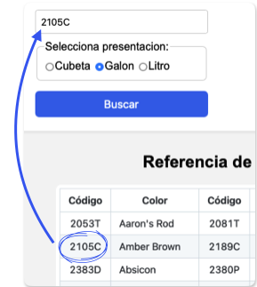

# Definición de colores

Aplicación para consultar la fórmula de tintas necesaria para preparar un color y conocer la base de pintura correspondiente.

**Prueba la aplicación:** [adalcarmona.github.io/colorDefinition](https://adalcarmona.github.io/colorDefinition/)

## ¿Cómo se usa la app?

1. Escribe el **nombre** o el **código** del color.
2. Selecciona la presentación: **litro**, **galón** o **cubeta**.
3. Pulsa **Buscar** para consultar el resultado.

La aplicación muestra el nombre y código del color, la base recomendada y las cantidades de cada tinta requeridas para la presentación seleccionada. El catálogo organiza cada fórmula por código e incluye datos para las presentaciones **Litro**, **Galón** y **Cubeta**, con cantidades expresadas en **oz** (onzas), **64** (1/64 de onza) y **128** (1/128 de onza).

## Bases disponibles segun seleccion de color

Las fórmulas del catálogo corresponden a una de estas bases de pintura, cada base en combinación con las tintas seleccionadas forman el color deseado:

- **Pastel**
- **Medium**
- **Deep**
- **Accent**

## Tecnologías usadas

- **HTML** para la estructura de la aplicación.
- **CSS** para los estilos.
- **JavaScript** para buscar colores, cargar el catálogo y mostrar las fórmulas.
- **JSON** para almacenar los datos de las fórmulas.
- **Node.js** y **SheetJS (`xlsx`)** para los scripts de consulta e importación desde Excel.

## Estructura de proyecto

```text
.
├── index.html                 # Página principal
├── package.json               # Configuración del proyecto y dependencia xlsx
├── scripts/
│   ├── consultarFormula.js    # Consulta de ejemplo de una fórmula
│   ├── convertExcel.js        # Convierte el libro Excel a JSON
│   └── inspectExcel.js        # Inspecciona el contenido del libro Excel
└── src/
    ├── css/
    │   └── styles.css        # Estilos de la aplicación
    ├── data/
    │   ├── formulas.json     # Catálogo cargado por la aplicación
    │   ├── formulas.xlsx     # Libro fuente de fórmulas
    │   └── formulas1008.json # Catálogo de datos adicional
    └── js/
        └── app.js            # Búsqueda y presentación de resultados
```

## Colores disponibles para probar

El catálogo incluido en [`src/data/formulas.json`](./src/data/formulas.json) contiene **30 colores**. Puedes buscar cualquiera de los siguientes por nombre o código:

| Código | Color | Código | Color | Código | Color |
|:---:|---|:---:|---|:---:|---|
| 2053T | Aaron's Rod | 2081T | Adobe | 2143P | Athena |
| 2105C | Amber Brown | 2189C | Adventure | 2963T | Atlantis Sky |
| 2383D | Absicon | 2380P | Aragon | 2760T | Audabon |
| 2397D | Abstract | 2045P | Arcadia | 2682T | August Grass |
| 2142P | Aleaha Rose | 2176P | Aria | 3000D | Blue Beard |
| 2951D | Abyss | 2705T | Arizona Sun | 2469C | Blue Bottle |
| 2543T | Alpine Azalea | 2410T | Armenian Blue | 2441C | Blue Crackle |
| 2240P | Acacia Blossom | 2395P | Artic Ice | 2463P | Blue Drizzle |
| 2720D | Acorn | 2401P | Ashley | 2453D | Willow Springs |
| 2723P | Adagio | 2007C | Asparagus | 2436P | Arbella |

## Captura de pantalla - Ejemplo de slección:




